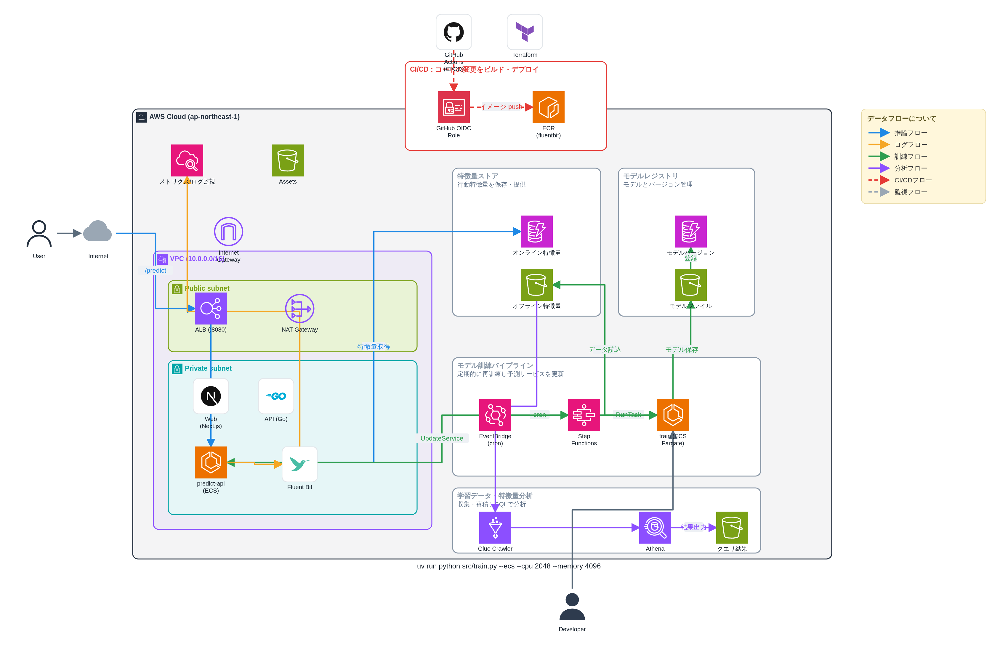

# AWS Architecture Studio

AWS のインフラ構成図をブラウザ上で作成し、**PowerPoint (.pptx) / SVG / PNG** に書き出し、プロジェクトを JSON で保存・復元できる専用エディタです。HTML プロトタイプを土台に **Vite + React + TypeScript** で再構築しています。



## 特長

- **公式 AWS アイコン 92 サービス**＋コンテナ枠 13 種＋アクター 10 種＋外部サービスロゴ 291 種（言語・DB・CI/CD・監視・SaaS ほか）
- **データフローの色分け**（推論 / ログ / 訓練 / 分析 / CI・CD / 監視）と自動**凡例**
- **直角（オルソゴナル）配線**とエッジラベル、直線配線の切替
- **入れ子コンテナ**（AWS Cloud → VPC → Subnet …）と**セクション枠**（タイトル＋説明文）
- **テキスト注釈**・**付箋(凡例)**・アクター配置
- **Terraform / CloudFormation インポート**（主要リソースを自動レイアウト）
- **Undo/Redo**、グリッド吸着、複製（Ctrl+D）、パン & ズーム
- **プロジェクトの保存・復元**（JSON ファイル／JSON テキスト）
- **MCP サーバ**（Claude から図の作成・編集・書き出しと、構成図のセキュリティ点検ができる）
- UI は**デジタル庁デザインシステム (DADS)** の公式コンポーネントとデザイントークンで構成（[src/dads/README.md](src/dads/README.md)）
- 依存ライブラリはバンドルされるため、ビルド後は**オフラインでも動作**

## セットアップ

```bash
npm install
npm run dev        # 開発サーバ (http://localhost:5173)
npm run build      # 本番ビルド → dist/
npm run preview    # ビルド結果をプレビュー

npm run build:mcp  # MCP サーバをビルド → mcp/dist/
npm run test:mcp   # MCP サーバの疎通確認
npm run typecheck  # アプリと MCP サーバの型チェック
```

Node.js 18 以上を推奨します。

## 使い方

1. 左パレットからキャンバスへ**ドラッグ**（ダブルクリックでも配置）。
2. ノードの右上にある**青い接続点**から別ノードへドラッグして**接続**。
3. 接続を選択し、右パネルで**フロー種別（色）・ラベル・配線**を設定。
4. 「追加」からセクション枠・テキスト・凡例を追加。
5. 「書き出す」から **PowerPoint / SVG / PNG** を出力。
6. 「操作」→「プロジェクト」から JSON を保存・復元。

「テンプレート」ボタンで MLOps 構成の作例を読み込めます。

## Claude から使う（MCP）

MCP サーバを同梱しています。Claude に登録すると、図の作成・編集・IaC の取り込み・各形式への
書き出しに加えて、**構成図からセキュリティ上の懸念を洗い出す**ことができます。

```bash
npm run build:mcp
claude mcp add aws-architecture-studio -- \
  node "$PWD/mcp/dist/stdio.js" --root "$PWD/diagrams"
```

セットアップ手順、24 個のツールの一覧、解析ルールの内容は **[docs/mcp.md](docs/mcp.md)** を参照してください。

なお解析は図に描かれた要素と位置関係のみに基づくもので、実際の AWS の設定は読みません。
結果は「実環境で確認すべき箇所」として扱ってください。

## ディレクトリ構成

```
src/
├─ main.tsx                # エントリ
├─ App.tsx                 # レイアウト・キーボード操作
├─ types.ts                # ドメイン型
├─ styles.css              # アプリ固有のレイアウト（DADS トークンのみ参照）
├─ dads/                   # デジタル庁デザインシステムの公式 CSS（無改変・MIT）
├─ data/
│  ├─ catalog.json         # アイコンカタログ（AWS公式SVG + ロゴ/アクター）
│  ├─ catalog.ts           # カタログ索引・IaCマッピング
│  └─ flows.ts             # フロー定義・定数
├─ store/
│  └─ useStore.ts          # Zustand ストア（履歴付き・doc/ops へ委譲）
├─ lib/
│  ├─ doc/{ops,containment}.ts  # 図の編集操作・矩形からの親子解決（アプリと MCP で共有）
│  ├─ analysis/security.ts      # 構成図のセキュリティ解析ルール
│  ├─ geometry.ts          # 図形・配線ルーティング
│  ├─ nodeFactory.ts       # ノード生成
│  ├─ docBuilder.ts        # サンプル / インポートのレイアウト
│  ├─ viewport.ts          # ズーム・パン・フィット
│  ├─ raster.ts            # SVG→PNG、ダウンロード
│  ├─ iac/parse.ts         # Terraform / CloudFormation 解析
│  └─ export/{pptx,svg,png,project}.ts  # 各種エクスポート
└─ components/
   ├─ Toolbar.tsx  Palette.tsx  Canvas.tsx
   ├─ NodeView.tsx  Edges.tsx  PropertiesPanel.tsx  Toast.tsx
   ├─ ui/dads.tsx          # DADS 部品の薄い React ラッパー
   └─ modals/{ImportModal,ProjectModal}.tsx

mcp/                       # MCP サーバ（Web ビルドには含まれない）
├─ stdio.ts  http.ts       # トランスポートごとの入口
├─ server.ts               # サーバ組み立て
├─ session.ts              # 編集中の図と履歴
├─ workspace.ts            # ファイル読み書きの範囲制限
├─ rasterize.ts            # resvg による SVG→PNG
├─ tools/                  # ツール定義
└─ smoke-test.mjs          # 疎通確認

scripts/build-logos.mjs    # docs/logo-candidates.md → catalog.json
```

## アイコン素材について

`src/data/catalog.json` は [aws-icons](https://www.npmjs.com/package/aws-icons)（AWS 公式アイコンセットベース）と
[simple-icons](https://simpleicons.org/)（外部サービスロゴ）から生成しています。各素材のライセンスに従ってご利用ください。
サービスの追加は `catalog.json` にエントリを追記するか、生成スクリプトを再実行してください。

## 技術スタック

Vite 5 / React 18 / TypeScript 5 / Zustand 4 / pptxgenjs 3 / js-yaml 4

MCP サーバ: @modelcontextprotocol/sdk 1.30 / zod 4 / @resvg/resvg-js 2（esbuild でバンドル）
